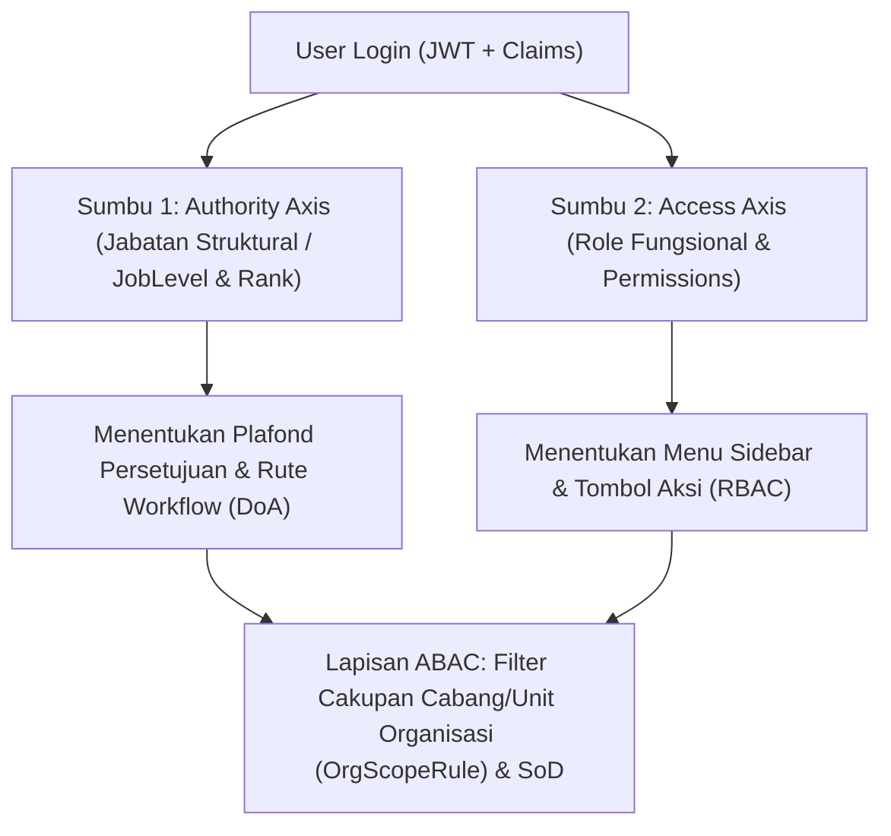

# Dokumentasi Lengkap & Panduan Arsitektur CoreEnterprise Boilerplate (v1.4.0)

Dokumen ini merangkum seluruh fitur, konsep arsitektur, panduan praktis penambahan modul/menu baru, mekanisme otorisasi berlapis (**RBAC + ABAC + DoA 3-Axis**), serta **Review & Peta Jalan Penyempurnaan (Roadmap)** untuk **CoreEnterprise Boilerplate**.

---

## Daftar Isi

1. [Gambaran Umum & Teknologi Inti (Tech Stack)](#bab-1-gambaran-umum--teknologi-inti-tech-stack)
2. [Katalog Fitur Boilerplate yang Sudah Tersedia](#bab-2-katalog-fitur-boilerplate-yang-sudah-tersedia)
3. [Konsep Otorisasi 2 Sumbu (2-Axis Authorization) & ABAC](#bab-3-konsep-otorisasi-2-sumbu-2-axis-authorization--abac)
4. [Hubungan Kode Menu (`MenuCode`), Role, dan Kode Permission (`PermissionCode`)](#bab-4-hubungan-kode-menu-menucode-role-dan-kode-permission-permissioncode)
5. [Standar Konvensi CRUD Permission Otomatis & Hook `useMenuAccess(menuCode)`](#bab-5-standar-konvensi-crud-permission-otomatis--hook-usemenuaccessmenucode)
6. [Tutorial Praktis: Menambahkan Menu Transaksi Baru & Membatasi Data per Cabang (Studi Kasus: Menu "Lihat Stock" Khusus Cabang Jakarta)](#bab-6-tutorial-praktis-menambahkan-menu-transaksi-baru--membatasi-data-per-cabang)
7. [Mesin Workflow Dinamis: Contextual DoA & 3-Axis Approver Resolution](#bab-7-mesin-workflow-dinamis-contextual-doa--3-axis-approver-resolution)
8. [Standar UI/UX Enterprise: Global Loading Overlay, Shell Modal, Sidebar & Multi-Bahasa (i18n)](#bab-8-standar-uiux-enterprise-global-loading-overlay-shell-modal-sidebar--multi-bahasa-i18n)
9. [Operasional IT Servicedesk, Notifikasi Email Admin (SMTP Outbox) & Kepatuhan Audit](#bab-9-operasional-it-servicedesk-notifikasi-email-admin-smtp-outbox--kepatuhan-audit)
10. [Review Komprehensif & Rekomendasi Fitur yang Perlu Disempurnakan / Ditambahkan](#bab-10-review-komprehensif--rekomendasi-fitur-yang-perlu-disempurnakan--ditambahkan)

---

## Bab 1: Gambaran Umum & Teknologi Inti (Tech Stack)

**CoreEnterprise Boilerplate** dirancang sebagai fondasi aplikasi bisnis skala korporasi (*Enterprise Resource Planning*, *Procurement*, *Finance*, *Inventory*, *HR*, dan *Workflow Approval*) yang memisahkan dengan tegas antara **mesin tata kelola sistem (governance engine)** dan **modul transaksi bisnis**.

### Spesifikasi Teknologi:
| Lapisan | Teknologi | Peran Utama |
| :--- | :--- | :--- |
| **Backend API** | **.NET 10 (ASP.NET Core Web API)** | Clean Architecture (`Domain`, `Application`, `Infrastructure`, `WebApi`), RESTful endpoints, JWT + Refresh Token Rotation. |
| **Database & ORM** | **PostgreSQL 16 + EF Core 9/10** | Penyimpanan relasional transaksional, `SaveChangesInterceptor` untuk Audit Trail otomatis, Auto-Migration & Seeder. |
| **Frontend UI** | **React 19 + TypeScript + Vite** | Single Page Application (SPA) modular dan cepat. |
| **UI Component** | **Mantine UI v7 + Tabler Icons** | Komponen Enterprise siap pakai, Dark/Light Mode, Custom Brand Color, Form & Modal standar. |
| **State & Fetching** | **Zustand + TanStack React Query + Axios** | Sinkronisasi state user/tema, caching data server, retry token otomatis, dan Global Center Loading Overlay. |
| **Multi-Bahasa** | **i18next (`id` & `en`) + Database Dictionary** | Kamus bahasa dinamis yang dapat diedit langsung dari menu **Application Settings** tanpa ubah kode. |

---

## Bab 2: Katalog Fitur Boilerplate yang Sudah Tersedia

Seluruh menu di bawah ini sudah aktif, terhubung ke database PostgreSQL, dan siap dipakai sebagai kerangka dasar aplikasi:

### A. Kelompok *Core Workspace*
1. **3-Axis Workflow Simulator (`simulator`)**
   - Simulasi *real-time* rute persetujuan dokumen berdasarkan Pemohon, Jenis Dokumen (`PO` / `DCP`), Sub-Kategori (`GENERAL`, `IT`, `RAW_MATERIAL`), dan Nilai Transaksi (Rp).
   - Menampilkan jejak resolusi (*Resolution Trace*) setiap tahapan approver beserta batas plafond dan SLA-nya.
2. **Contoh PO & DCP (`transactions`)**
   - Contoh nyata implementasi transaksi **Header-Detail (Parent-Child)** dengan penomoran otomatis, kalkulasi PPN 11%, lampiran dokumen (DMS), pengajuan workflow, *Approval Inbox*, *Send Back (Revisi)* dengan perbandingan siklus revisi (*Diff Viewer*), serta proteksi *4-Eyes Segregation of Duties (SoD)* dan validasi *Digital Signature*.

### B. Kelompok *Governance & Master Data*
3. **DoA Policy Matrix (`doa-matrix`)**
   - CRUD Matriks *Delegation of Authority (DoA)* kontekstual berdasarkan kode dokumen, sub-kategori, rentang nominal (`MinAmount` – `MaxAmount`), urutan step (`StepSequence`), level jabatan target (`TargetJobLevelCode`), tipe peran (`REVIEWER` vs `FINAL_APPROVAL`), dan SLA (jam).
4. **Approver Matrix & Org Tree (`approver-matrix`)**
   - Visualisasi pohon hierarki organisasi (**Holding -> Company -> Area -> Estate/Mill -> Division -> Department**) serta penugasan pejabat approver khusus pada unit organisasi tertentu.

### C. Kelompok *Identity & Access (IAM)*
5. **User Management (`user-management`)**
   - CRUD Pengguna Aplikasi lengkap dengan Nomor Induk Pegawai (NIK), Username, Email, **Nomor Handphone**, **Masa Berlaku Akun (`Valid From` & `Valid Upto`)**, Jabatan Struktural (Sumbu 1), Unit Organisasi Utama, Atasan Langsung, dan Multi-Role Fungsional (Sumbu 2).
6. **Menu Management — RBAC (`menu-rbac`)**
   - **Tab 1:** Master Daftar Menu Aplikasi (mengatur judul, grup kategori sidebar, urutan tampil, ikon, visibilitas, role yang diizinkan, serta **Auto-Generate 6 Standard CRUD Permissions**).
   - **Tab 2:** Master Role Fungsional (Sumbu 2 — `SUPERADMIN`, `MASTER_DATA`, `SERVICEDESK`, `AUDITOR`, `EMPLOYEE`, atau role baru seperti `BRANCH_ADMIN`).
   - **Tab 3:** Matriks Role vs Permission (centang/lepas centang hak akses tombol secara *live*).
7. **ABAC Policy Rules (`abac-management`)**
   - CRUD aturan *Attribute-Based Access Control* untuk membatasi akses berdasarkan atribut kontekstual: Level Jabatan, Rentang Rank, Role, **Cakupan Unit Organisasi (`SAME_DEPARTMENT_ONLY`, `SAME_ORG_BRANCH_UPWARD`, `HEAD_OFFICE_ONLY`, `ANY_ORG_UNIT`)**, Sub-Kategori, Plafond Maksimal, aturan *4-Eyes SoD*, dan kewajiban Tanda Tangan Digital, dilengkapi **ABAC Rule Evaluator / Simulator**.

### D. Kelompok *Compliance & Operations*
8. **Audit Trail — Immutable (`audit-trail`)**
   - Pencatatan otomatis (`INSERT`, `UPDATE`, `DELETE`, `WORKFLOW_ACTION`, `SECURITY`) ke tabel `AuditLogs` lengkap dengan *JSON Snapshot* nilai lama (`OldValuesJson`) dan nilai baru (`NewValuesJson`) yang tidak dapat diubah/dihapus.
9. **DMS Repository (`dms-repository`)**
   - Manajemen berkas dokumen terpusat dengan perhitungan hash integritas **SHA-256**, validasi ukuran/tipe file, dan tautan ke dokumen transaksi atau profil user.
10. **SLA Bottleneck Monitor (`sla-monitor`)**
    - Pemantauan dokumen yang tertahan di meja approver dan mendekati atau melewati batas waktu SLA.
11. **IT Servicedesk (`it-servicedesk`)**
    - Pencarian cepat akun pengguna, **Lock / Unlock Akun**, **Reset Password Sementara**, pengiriman **Email Pemberitahuan Resmi Otomatis** ke user terkait, serta **Tab Log Email Pemberitahuan Akun (SMTP Outbox)**.
12. **Application Settings (`app-settings`)**
    - **Tab 1:** Identitas & Branding Aplikasi (Judul Aplikasi, Sub-Judul, Ikon Logo, Versi Badge, Nama Perusahaan, dan *Global Broadcast Banner*).
    - **Tab 2:** **Akun Email Admin & SMTP Transaksi** (konfigurasi email pengirim resmi admin aplikasi, Reply-To Servicedesk, CC Security Audit, SMTP Host/Port/SSL, dan fitur **Kirim Test Email**).
    - **Tab 3:** Parameter Sistem Dinamis (`SECURITY`, `WORKFLOW`, `DMS`, `BRANDING`, `EMAIL`).
    - **Tab 4:** **Kamus Multi-Bahasa (`i18n Dictionary`)** untuk mengubah istilah bahasa Indonesia (`ID`) dan Inggris (`EN`) secara *real-time*.

---

## Bab 3: Konsep Otorisasi 2 Sumbu (2-Axis Authorization) & ABAC

Boilerplate ini memisahkan kewenangan pegawai ke dalam **2 sumbu independen** ditambah **1 lapisan filter atribut (ABAC)**:



1. **Sumbu 1 — *Authority Axis* (`JobLevel` + `RankOrder` + `PrimaryOrgUnit`)**:
   - Menunjukkan posisi struktural karyawan di perusahaan (misal: `STAFF` Rank 10, `SPV` Rank 20, `MGR` Rank 30, `GM` Rank 40, `DIR` Rank 60, `PRESDIR` Rank 80).
   - **Tidak otomatis menentukan menu apa yang tampil**, melainkan menentukan **wewenang persetujuan finansial (DoA)** dan hierarki atasan-bawahan.
2. **Sumbu 2 — *Access Axis* (`Roles` + `Permissions`)**:
   - Menunjukkan peran fungsional di sistem (misal: `EMPLOYEE`, `MASTER_DATA`, `SERVICEDESK`, `AUDITOR`, `SUPERADMIN`).
   - Menentukan **menu apa yang muncul di sidebar kiri** dan **tombol apa yang menyala di dalam layar**.
3. **Aturan Khusus *Auditor Read-Only* (Segregation of Duties)**:
   - User yang hanya memegang role `AUDITOR` otomatis dikenakan mode **Global Read-Only**: dapat melihat seluruh menu pengawasan dan laporan untuk keperluan audit, tetapi seluruh tombol tambah/ubah/hapus/approve dikunci oleh sistem.

---

## Bab 4: Hubungan Kode Menu (`MenuCode`), Role, dan Kode Permission (`PermissionCode`)

Banyak developer bingung membedakan fungsi **Menu**, **Role**, dan **Permission**. Di boilerplate ini, ketiganya memiliki pembagian tugas yang sangat jelas:

| Komponen | Mengatur Apa? | Pertanyaan yang Dijawab | Contoh Nilai |
| :--- | :--- | :--- | :--- |
| **1. `MenuCode` + `AllowedRoles`** *(Level Pintu Ruangan)* | Mengatur apakah **Menu di Sidebar Kiri** muncul atau disembunyikan untuk user tertentu. | *"Bolehkah user ini melihat dan masuk ke menu Purchase Request?"* | `menuCode: "pr"`<br>`allowedRoleCodes: ["PURCHASING", "SUPERADMIN"]` |
| **2. `PermissionCode`** *(Level Saklar Tombol di Dalam Ruangan)* | Mengatur apakah **Tombol Aksi Spesifik** (`+ Tambah`, `Edit`, `Hapus`, `Approve`, `Export`) di dalam layar menu tersebut **bisa diklik (aktif)** atau **terkunci (disabled)**, serta memproteksi endpoint API-nya. | *"Setelah masuk ke layar PR, bolehkah user ini menekan tombol + Tambah PR atau Hapus PR?"* | `PR.Read`<br>`PR.Create`<br>`PR.Edit`<br>`PR.Delete`<br>`PR.Approve`<br>`PR.Export` |

### Mengapa Dipisahkan antara Menu dan Permission Tombol?
Karena di dunia nyata, sering kali **2 orang sama-sama boleh membuka menu yang sama, tetapi aksi tombol yang boleh mereka tekan berbeda**:
- **Staff Gudang** & **Supervisor Gudang** sama-sama boleh membuka menu **Purchase Request (`pr`)**.
- Namun **Staff Gudang** hanya boleh menekan tombol **Lihat (`PR.Read`)** dan **+ Tambah (`PR.Create`)**, **tidak boleh** menekan tombol **Approve (`PR.Approve`)** atau **Hapus (`PR.Delete`)**.
- Sedangkan **Supervisor Gudang** boleh menekan tombol **Approve (`PR.Approve`)**.

### Bagian Mana yang Ditulis di Kodingan vs Bagian Mana yang Dinamis di Database?
- **Yang ditulis 1 kali di kodingan (sebagai "Label Saklar")**:
  Saat programmer membuat halaman React dan endpoint API, programmer menempelkan kode permission pada tombol (misalnya `disabled={!canCreate}`).
- **Yang 100% Dinamis di Database (Tanpa Hardcode)**:
  **Siapa / Role mana** yang mendapatkan `PR.Create` atau `PR.Approve` **sama sekali tidak di-hardcode di kodingan**. Admin cukup membuka menu **Menu Management (RBAC) -> Tab 3 (Matriks Role vs Permission)**, lalu mencentang atau melepas centang kapan saja tanpa perlu *build* atau *deploy* ulang aplikasi.

---

## Bab 5: Standar Konvensi CRUD Permission Otomatis & Hook `useMenuAccess(menuCode)`

Agar programmer **tidak perlu mengarang nama kode permission yang berbeda-beda** di setiap halaman baru (misalnya ada yang menulis `PR.Add`, `PO.Insert`, `Stock.New`), boilerplate ini menyediakan **Standar Konvensi Otomatis Berbasis `MenuCode`**.

### 1. Aturan Konvensi Penamaan (`toPermissionPrefix`)
Setiap `menuCode` otomatis dikonversi menjadi prefix modul berformat **PascalCase** (atau huruf besar jika singkat <= 4 karakter):
- `menuCode: "lihat-stock"` $\rightarrow$ Prefix: **`LihatStock`**
- `menuCode: "purchase-request"` $\rightarrow$ Prefix: **`PurchaseRequest`**
- `menuCode: "pr"` $\rightarrow$ Prefix: **`PR`**

Dan setiap menu otomatis memiliki **6 Kode Permission Standar**:
1. `{Prefix}.Read` — Lihat daftar & detail data pada menu
2. `{Prefix}.Create` — Tombol **+ Tambah** data baru
3. `{Prefix}.Edit` — Tombol **Edit / Ubah** data
4. `{Prefix}.Delete` — Tombol **Hapus** data
5. `{Prefix}.Approve` — Tombol **Approve / Reject** dokumen
6. `{Prefix}.Export` — Tombol **Export Excel / PDF**

### 2. Cara Kerja Auto-Generate di UI Menu Management (RBAC)
1. Buka menu **Menu Management (RBAC)** $\rightarrow$ Klik **+ Tambah Menu Aplikasi**.
2. Isi `Kode Menu (MenuCode)` (misal: `lihat-stock`) dan `Judul Menu` (misal: `Lihat Stock Cabang`).
3. Pastikan saklar **"Auto-Generate 6 Standard CRUD Permissions (Read, Create, Edit, Delete, Approve, Export)"** menyala (**ON** secara default).
4. Klik **Simpan Konfigurasi Menu**.
5. Sistem Backend otomatis:
   - Membuat ke-6 permission (`LihatStock.Read`, `LihatStock.Create`, `LihatStock.Edit`, `LihatStock.Delete`, `LihatStock.Approve`, `LihatStock.Export`) di tabel `Permissions`.
   - Memberikan ke-6 permission tersebut ke `SUPERADMIN`.
   - Memberikan permission dasar `LihatStock.Read` ke seluruh Role yang dipilih pada `Allowed Roles`.
6. Untuk menu lama yang sudah ada, Admin juga bisa menekan tombol ikon **✨ (Generate 6 Standard CRUD Permissions)** di baris tabel menu kapan saja.

### 3. Cara Pakai di Komponen React (`useMenuAccess`)
Di dalam file halaman React baru (misal `LihatStockView.tsx`), programmer cukup memanggil **1 baris hook** dari `src/hooks/useAccess.ts`:

```tsx
import { useMenuAccess } from '../hooks/useAccess';

export function LihatStockView() {
  // Otomatis mengecek LihatStock.Read, LihatStock.Create, LihatStock.Edit, dst.
  const { canRead, canCreate, canEdit, canDelete, canApprove, canExport } = useMenuAccess('lihat-stock');

  return (
    <Group>
      <Button disabled={!canCreate}>+ Tambah Stock</Button>
      <Button disabled={!canEdit}>Ubah</Button>
      <Button color="red" disabled={!canDelete}>Hapus</Button>
      <Button color="teal" disabled={!canApprove}>Approve Opname</Button>
      <Button variant="default" disabled={!canExport}>Export Excel</Button>
    </Group>
  );
}
```

---

## Bab 6: Tutorial Praktis: Menambahkan Menu Transaksi Baru & Membatasi Data per Cabang

**Studi Kasus Nyata:**
> *"Jika ada 1 menu transaksi baru, contohnya **Lihat Stock**, bagaimana cara saya men-setting agar 1 user mendapatkan menu baru itu dan dia **hanya bisa melihat cabang Jakarta saja**?"*

Di dalam arsitektur **CoreEnterprise Boilerplate**, kebutuhan ini diselesaikan dengan menggabungkan **RBAC (Hak Akses Menu & Tombol)** + **Struktur Unit Organisasi User (`PrimaryOrgUnit`) & ABAC (Hak Akses Cakupan Data Cabang)**.

Berikut langkah-langkah lengkapnya:

### Langkah 1: Pastikan Unit Organisasi Cabang Jakarta Terdaftar
1. Buka menu **Approver Matrix & Org Tree**.
2. Pastikan unit organisasi cabang sudah ada, misalnya:
   - Kode Unit: `CAB-JKT`
   - Nama Unit: `Cabang Jakarta`
   - Tipe Unit: `AREA` atau `COMPANY`

### Langkah 2: Buat Role (Jika Ingin Role Khusus) & Daftarkan Menu `lihat-stock`
1. Buka menu **Menu Management (RBAC)**:
   - Di **Tab 2 (Master Role Fungsional)**, Anda bisa membuat role baru misalnya `ADMIN_STOCK` (atau menggunakan role yang ada).
   - Di **Tab 1 (Daftar Menu Aplikasi)**, klik **+ Tambah Menu Aplikasi**:
     - **Kode Menu (`MenuCode`)**: `lihat-stock`
     - **Judul Menu**: `Lihat Stock`
     - **Role yang Diizinkan (`Allowed Roles`)**: Pilih `SUPERADMIN`, `ADMIN_STOCK`
     - **Auto-Generate 6 Standard CRUD Permissions**: **ON (Aktif)**
   - Klik **Simpan**. Sistem otomatis membuat `LihatStock.Read`, `LihatStock.Create`, dll.
   - Di **Tab 3 (Matriks Role vs Permission)**, pastikan `ADMIN_STOCK` dicentang pada `LihatStock.Read` (dan `LihatStock.Export` jika boleh mengunduh laporan).

### Langkah 3: Setting User agar Berada di Cabang Jakarta (`CAB-JKT`)
1. Buka menu **User Management**.
2. Edit user yang bersangkutan (atau klik **+ Tambah Pengguna Baru**):
   - **Unit Organisasi Utama (`PrimaryOrgUnit`)**: Pilih **`CAB-JKT — Cabang Jakarta`**.
   - **Role Fungsional (Sumbu 2)**: Pilih **`ADMIN_STOCK`**.
3. Klik **Simpan**.
   - Hasil sampai tahap ini: Saat user tersebut login, menu **Lihat Stock** langsung muncul di sidebar kirinya, dan token/sesi login user tersebut membawa identitas `orgUnitId` & `orgUnitCode = "CAB-JKT"`.

### Langkah 4: Pasang Aturan Cakupan Cabang di ABAC Policy Rules
1. Buka menu **ABAC Policy Rules** $\rightarrow$ Klik **+ Tambah Kebijakan ABAC**:
   - **Kode Kebijakan**: `ABAC-STOCK-CABANG`
   - **Nama Kebijakan**: `Isolasi Data Stock Hanya Sesama Cabang/Unit Organisasi`
   - **Target Resource**: `STOCK`
   - **Target Action**: `READ`
   - **Subject Roles**: `ADMIN_STOCK`
   - **Aturan Cakupan Organisasi (`OrgScopeRule`)**:
     - Pilih **`SAME_DEPARTMENT_ONLY`** jika user **hanya boleh melihat persis unit `CAB-JKT` saja**, ATAU
     - Pilih **`SAME_ORG_BRANCH_UPWARD`** jika user di `CAB-JKT` boleh melihat `CAB-JKT` beserta gudang/divisi di bawah `CAB-JKT`.
   - **Efek**: `ALLOW`

### Langkah 5: Filter Query di Backend API Berdasarkan Unit Organisasi User
Pada endpoint API Backend untuk menu Lihat Stock (misalnya `GET /api/Stocks`), cukup gunakan `PrimaryOrgUnitId` milik user yang sedang login:

```csharp
[HttpGet]
public async Task<IActionResult> GetStocks(CancellationToken cancellationToken)
{
    var currentUserId = _currentUser.UserId;
    var user = await _context.Users
        .Include(u => u.PrimaryOrgUnit)
        .Include(u => u.UserRoles).ThenInclude(ur => ur.Role)
        .FirstOrDefaultAsync(u => u.Id == currentUserId, cancellationToken);

    var isSuperAdminOrHo = user.UserRoles.Any(r => r.Role.Code == "SUPERADMIN" || r.Role.Code == "AUDITOR")
                           || user.PrimaryOrgUnit.Code == "HO";

    var query = _context.Stocks.AsNoTracking();

    // Jika bukan SuperAdmin / Kantor Pusat (HO), kunci filter HANYA ke cabang user tersebut (misal: CAB-JKT)
    if (!isSuperAdminOrHo)
    {
        query = query.Where(s => s.OrgUnitId == user.PrimaryOrgUnitId);
    }

    var result = await query.ToListAsync(cancellationToken);
    return Ok(result);
}
```
Dengan pola ini, **tanpa mengubah kodingan sama sekali**, jika besok ada user kedua yang ditempatkan di **Cabang Surabaya (`CAB-SBY`)** dengan role `ADMIN_STOCK`, maka otomatis user pertama hanya melihat stok **Jakarta** dan user kedua hanya melihat stok **Surabaya**!

---

## Bab 7: Mesin Workflow Dinamis: Contextual DoA & 3-Axis Approver Resolution

Untuk setiap dokumen transaksi yang membutuhkan persetujuan berjenjang (seperti PO, PR, DCP, Reimbursement, Mutasi Barang), boilerplate ini menyediakan mesin **3-Axis Approver Resolution**:

1. **Contextual DoA Policy Matrix**:
   - Menentukan tahapan persetujuan berdasarkan **Jenis Dokumen (`DocTypeCode`)**, **Sub-Kategori (`SubCategoryCode`)**, dan **Nominal Transaksi (`TransactionAmount`)**.
2. **Resolusi Pejabat Approver Otomatis (Upward Tree Walk)**:
   - Untuk setiap tahapan (`StepSequence`), mesin mencari pejabat yang memiliki `JobLevel` sesuai target (`TargetJobLevelCode`, misal `MGR`, `GM`, `DIR`) dengan menelusuri pohon organisasi **dari unit pemohon naik ke induknya (Parent Unit)** hingga ke Holding (`HO`).
3. **Fitur Siklus Revisi (*Send Back*) & *4-Eyes Principle (SoD)***:
   - Approver dapat melakukan **Approve**, **Reject**, atau **Send Back (Revisi)** ke pemohon.
   - Saat dokumen direvisi dan disubmit ulang, siklus revisi bertambah (`RevisionCycle + 1`) dan sistem menyimpan *snapshot* perubahan untuk dibandingkan.
   - Mesin mencegah pemohon menyetujui dokumennya sendiri (*Self-Approval Prevention / 4-Eyes SoD*).

---

## Bab 8: Standar UI/UX Enterprise: Global Loading Overlay, Shell Modal, Sidebar & Multi-Bahasa (i18n)

Boilerplate ini telah dilengkapi standar komponen antarmuka yang seragam:

1. **Global Center Loading Overlay Otomatis (`App.tsx` + `apiClient.ts` + `useAppStore.ts`)**:
   - Setiap kali aplikasi mengambil data (`GET`) atau menyimpan/mengubah data (`POST`/`PUT`/`DELETE`) melalui React Query maupun `apiClient`, otomatis muncul indikator **Spinner Loading di tengah layar (`Memuat data... / Loading data...`)** dengan efek blur tipis.
   - Jika ada request background yang sengaja tidak ingin menampilkan loading di tengah layar, cukup sertakan header `{'X-Silent-Loading': 'true'}`.
2. **Komponen `EnterpriseModalShell` & `EnterpriseFormSection` (`EnterpriseModalShell.tsx`)**:
   - Seluruh form modal menggunakan cangkang standar dengan header berikon, badge status, footer tombol aksi yang konsisten, pembersihan penomoran sub-judul otomatis, serta proteksi label form (`white-space: nowrap`) agar label input tidak terpotong/melipat ke baris bawah.
3. **Navigasi Sidebar Kiri Pintar**:
   - Mendukung pencarian cepat menu (*Quick Filter*), **Expand All / Collapse All** maupun buka-tutup per grup kategori, penyaringan otomatis sesuai Role user login (`allowedRoleCodes`), serta tampilan minimalis tanpa teks deskripsi yang memenuhi layar.
4. **Kamus Multi-Bahasa Dinamis (`i18n Dictionary`)**:
   - Mendukung pergantian bahasa **Indonesia (`ID`)** dan **Inggris (`EN`)** secara instan di header atas, dengan kamus kata yang tersimpan di tabel `AppI18nEntries` dan dapat ditambah/diedit lewat menu **Application Settings**.

---

## Bab 9: Operasional IT Servicedesk, Notifikasi Email Admin (SMTP Outbox) & Kepatuhan Audit

1. **Pengaturan Akun Email Admin Aplikasi (`Application Settings -> Tab 2`)**:
   - Menyimpan konfigurasi terpusat `ADMIN_SENDER_EMAIL`, `ADMIN_SENDER_NAME`, `ADMIN_SUPPORT_REPLY_TO`, `EMAIL_CC_SECURITY_AUDIT`, serta parameter `SMTP_HOST`, `SMTP_PORT`, `SMTP_USERNAME`, `SMTP_USE_SSL`, dan saklar `EMAIL_NOTIFICATION_ENABLED`.
   - Layanan `EnterpriseEmailDispatcher` siap dipanggil oleh modul apa pun untuk mengirim email notifikasi dan mencatat setiap pengiriman ke tabel `EmailDispatchLogs`.
2. **Notifikasi Otomatis IT Servicedesk**:
   - Saat petugas Servicedesk mengunci (`LOCKED`) atau membuka (`ACTIVE`) akun user, maupun melakukan **Reset Password**, sistem otomatis mengirim email pemberitahuan resmi ke alamat email user yang bersangkutan beserta notifikasi *in-app* (lonceng notifikasi).
3. **Masa Berlaku Akun (`Valid From` & `Valid Upto`)**:
   - Pada saat login (`POST /api/Auth/login`), sistem memvalidasi apakah tanggal hari ini berada dalam rentang `ValidFrom` s/d `ValidTo` milik user. Jika masa berlaku akun sudah habis (contoh: akun vendor/kontraktor/pejabat sementara), login otomatis ditolak dengan pesan yang jelas.

---

## Bab 10: Review Komprehensif & Rekomendasi Fitur yang Perlu Disempurnakan / Ditambahkan

Sebagai evaluasi menyeluruh terhadap kondisi boilerplate saat ini, fondasi **IAM (RBAC + ABAC), Workflow DoA, Audit Trail, DMS, Servicedesk, dan UI Shell** sudah berada pada level **sangat matang (~85% Enterprise-Ready)**.

Namun, agar boilerplate ini menjadi **100% sempurna dan tahan banting (Production-Grade)** ketika dipakai untuk membangun berbagai aplikasi transaksi skala besar, berikut adalah daftar fitur dan penyempurnaan yang direkomendasikan:

### I. Prioritas Tinggi (Keamanan & Integritas Backend)

1. **Penegakan Middleware / Filter Otorisasi Otomatis di Semua Endpoint Backend (`[RequirePermission]` & ABAC Guard)**
   - **Kondisi Saat Ini:** Beberapa controller administrasi (`SuperAdminController`, `UserManagementController`, `AppSettingsController`) sudah diproteksi di sisi UI React, tetapi di sisi Backend belum semuanya dipasangi atribut filter `[Authorize]` / pengecekan permission granular per action.
   - **Penyempurnaan:** Buat custom attribute C# seperti `[HasPermission("LihatStock.Create")]` atau `[RequireSystemAdmin]` sehingga proteksi API di sisi Backend menjadi 1 baris deklaratif yang seragam dengan `useMenuAccess` di Frontend.
2. **Koneksi Pengiriman SMTP Nyata (`MailKit` / `SmtpClient`) dengan Background Queue**
   - **Kondisi Saat Ini:** `EnterpriseEmailDispatcher` sudah menyusun template email resmi menggunakan konfigurasi SMTP dari database dan mencatatnya ke `EmailDispatchLogs` (`SENT_OUTBOX`).
   - **Penyempurnaan:** Tambahkan opsi pengiriman fisik via library `MailKit` / `.NET SmtpClient` di dalam *Background Channel/Queue* (agar proses klik tombol tidak melambat menunggu server SMTP eksternal), lengkap dengan mekanisme *Auto-Retry* jika SMTP gagal.
3. **Enkripsi Password SMTP & Secret Parameter di `AppSettings`**
   - **Kondisi Saat Ini:** Parameter di `AppSettingItems` disimpan sebagai teks biasa.
   - **Penyempurnaan:** Tambahkan tipe nilai `SECRET` / `PASSWORD` yang di-mask (`••••••••`) di layar UI **Application Settings** dan dienkripsi menggunakan `IDataProtectionProvider` milik ASP.NET Core saat disimpan ke database.

### II. Prioritas Menengah (Kelengkapan Fitur Operasional Enterprise)

4. **Delegasi Wewenang Sementara (*Acting / Pelaksana Tugas - Plt. / Out-of-Office Delegation*)**
   - **Kebutuhan Nyata:** Ketika seorang Manager/GM sedang cuti atau dinas luar kota, dokumen workflow tidak boleh macet (SLA breach).
   - **Rekomendasi Fitur:** Tambahkan tabel & menu **Delegation / Acting Assignment** (`FromUserId`, `ToDelegateUserId`, `ValidFrom`, `ValidTo`, `DocTypeScope`) sehingga mesin 3-Axis Workflow otomatis mengalihkan tugas approval ke pejabat pengganti selama periode aktif.
5. **Komponen Tabel Data Standar (*Reusable `<EnterpriseDataTable />`*) dengan Server-Side Pagination, Sorting, Filter & Export Excel/CSV**
   - **Kondisi Saat Ini:** Tabel di masing-masing halaman merender seluruh array data sekaligus. Jika nanti tabel transaksi (PO, Stock, Jurnal, Audit Log) mencapai puluhan ribu baris, render di browser akan melambat.
   - **Rekomendasi Fitur:** Buat 1 komponen standar `<EnterpriseDataTable />` di boilerplate yang sudah memiliki fitur bawaan:
     - Pencarian (*Search*), Filter kolom, dan *Sorting* kolom.
     - *Pagination* (`10 / 25 / 50 / 100` baris per halaman).
     - Tombol **Export Excel (`.xlsx`) / CSV** dan **Print PDF** yang otomatis terhubung ke permission `{MenuCode}.Export`.
6. **Generator Nomor Dokumen Otomatis yang Dapat Dikonfigurasi (*Document Numbering Series Engine*)**
   - **Kondisi Saat Ini:** Format nomor dokumen (`PO/2026/...`) masih ditulis di dalam kode controller.
   - **Rekomendasi Fitur:** Tambahkan master **Format Penomoran Dokumen (Running Number Generator)** di menu Admin (misalnya pola: `{DOC}/{ORG}/{YYYY}/{MM}/{SEQ:4}` dengan reset bulanan/tahunan otomatis dan *concurrency lock* agar tidak pernah terjadi nomor ganda).
7. **Master Kalender Hari Libur Kerja (*Working Calendar & Holiday Master*) untuk Kalkulasi SLA**
   - **Kondisi Saat Ini:** Perhitungan `DueDateSla` pada workflow masih menjumlahkan jam secara kalender murni (`DateTime.UtcNow.AddHours(slaHours)`), termasuk hari Sabtu, Minggu, dan tanggal merah.
   - **Rekomendasi Fitur:** Tambahkan master **Hari Libur & Jam Kerja** agar perhitungan tenggat SLA hanya menghitung jam/hari kerja efektif.

### III. Prioritas Pengembangan Developer Experience (DX) & Skalabilitas

8. **Code Splitting / Lazy Loading Halaman Menu (`React.lazy` + `Suspense`)**
   - **Kondisi Saat Ini:** Seluruh komponen halaman diimpor sekaligus di `App.tsx`, sehingga ukuran bundle JS utama sekitar ~911 KB.
   - **Penyempurnaan:** Gunakan `React.lazy(() => import(...))` untuk setiap menu sehingga browser hanya mengunduh kode halaman yang sedang dibuka oleh user (ukuran bundle awal akan turun drastis menjadi < 250 KB).
9. **Dynamic Component Registry untuk Menu Baru**
   - **Kondisi Saat Ini:** Ketika membuat komponen halaman baru, programmer mendaftarkan mapping `resolvedActiveMenu === 'kode-menu'` di `App.tsx`.
   - **Penyempurnaan:** Buat satu file pusat `src/registry/menuRegistry.tsx` yang memetakan `menuCode` ke komponen React-nya, sehingga ketika tim Anda membuat 20–50 menu transaksi baru nanti, file `App.tsx` tidak perlu disentuh lagi.
10. **Fitur *Self-Service Change Password* & Kebijakan Kompleksitas Password**
    - **Penyempurnaan:** Tambahkan form **Ubah Password Saya** di halaman **Profil Saya**, lengkap dengan validasi aturan keamanan dari `AppSettings` (panjang minimal karakter, kombinasi huruf besar/kecil/angka/simbol, dan paksa ganti password saat pertama kali login setelah di-reset oleh Servicedesk).

---
*Dokumen ini disusun otomatis sesuai kondisi aktual kode sumber **CoreEnterprise Boilerplate v1.4.0**.*

